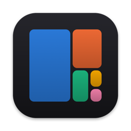
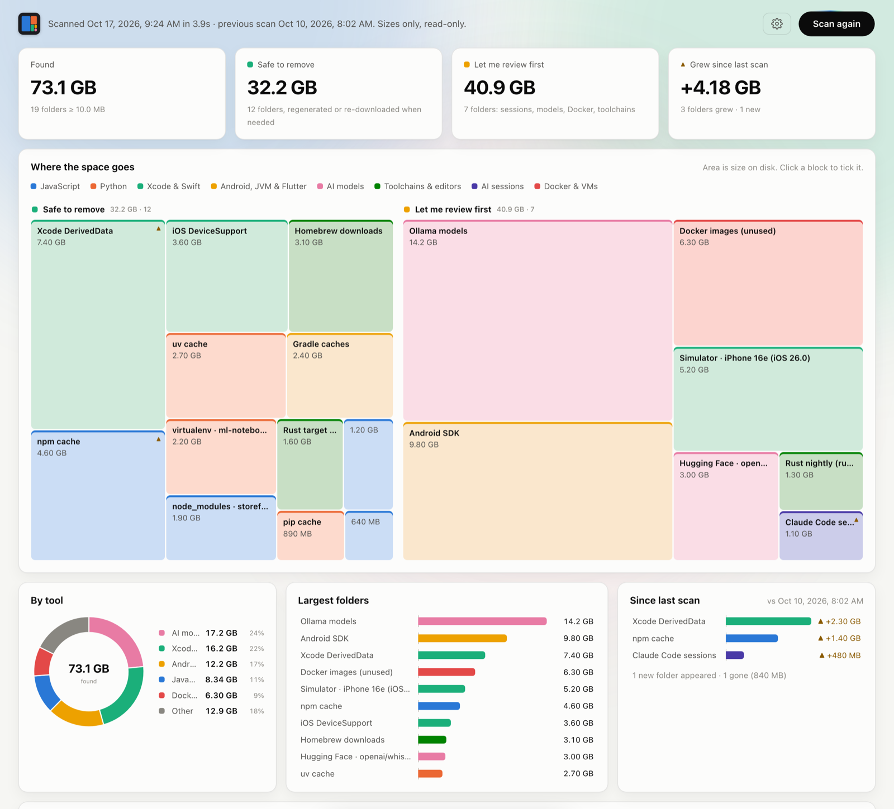

<p align="center">
  
</p>

<h1 align="center">DevDisk</h1>

<p align="center">
  Find the disk space your dev work left behind, and clean it up with each tool's own clean command.
</p>

<p align="center">
  
  
  
  
  <a href="LICENSE"></a>
</p>

<picture>
  <source media="(prefers-color-scheme: dark)" srcset="docs/screenshot-dark.png">
  
</picture>

## Why I built this

My Mac kept running low on space, and it was always dev stuff: `node_modules` in projects I hadn't
opened in months, Xcode DerivedData, simulators full of test apps, pip and npm caches, Ollama and Hugging
Face models, Docker images. Generic disk tools show me *where* the space is, but not what's safe to
delete or what happens if I do.

So I built DevDisk. It knows about 90 kinds of dev leftovers. It tells you what each folder is, what
breaks if it's gone, and cleans it the way the tool itself would (`npm cache clean`, `brew cleanup`,
`xcrun simctl erase`, `ollama rm`, `hf cache rm`…) instead of just `rm -rf`-ing things.

## Features

- **Treemap of where the space went**, split into **Safe to remove** and **Let me review first**.
  AI sessions, models and Docker always go under review.
- **Every item says what happens if you delete it**, so you're not guessing.
- **Cleanup uses each tool's own clean command.** Folders with no command go to the Trash, so you can
  drag them back out.
- **You confirm every item first**, then watch a live log of what ran. Each log is also saved to disk.
- **Tracks growth over time.** Every scan is appended to `~/disk-report/sizes.csv`, and the next scan
  flags what grew, what's new and what's gone.
- **Read-only scan.** It looks at sizes only and never opens a file. A full scan takes a few seconds.
- **Plays nice with macOS privacy.** It never touches iCloud, the Photos library, external drives or
  folders that would pop up a permission prompt. Desktop, Documents and Downloads are opt-in, and your
  answer is remembered.
- **No network, no telemetry, no dependencies.** It's a small native Swift app with a plain
  HTML/CSS/JS UI.

## What it finds

| | |
|---|---|
| **JavaScript** | `node_modules`, `.next`, Nuxt, SvelteKit, npm / Yarn / pnpm / Bun / Deno caches, Playwright & Puppeteer browsers, nvm Node versions |
| **Python** | virtualenvs, tox/nox, `__pycache__` & tool caches, pip, uv, Poetry, pre-commit, Conda package caches, pyenv versions |
| **Xcode & Swift** | DerivedData, DeviceSupport, simulators (one item per device), SwiftUI Preview simulators, Archives, SwiftPM & CocoaPods caches, project `.build` and `Pods` |
| **Android, JVM & Flutter** | Android SDK & emulators, Gradle & Maven caches, project `build/` & `target/`, pub cache, `.dart_tool` |
| **AI models** | Ollama (per model), Hugging Face (per repo), LM Studio, PyTorch hub, Whisper, llama.cpp, Keras |
| **AI sessions** | Claude Code, Codex, Gemini CLI, Cursor and VS Code workspace state |
| **Toolchains & editors** | Homebrew, Cargo, rustup toolchains, Go, RubyGems, JetBrains, VS Code & Cursor caches and extensions, Terraform providers |
| **Docker & VMs** | Docker images, containers, volumes and build cache (via `docker system df`), Colima, Lima, minikube, Vagrant, VirtualBox |

Anything under 10 MB is hidden.

## Install

You'll need macOS 14 or later on Apple Silicon, and the Xcode Command Line Tools
(`xcode-select --install`).

```sh
git clone https://github.com/santosays/DevDisk.git
cd DevDisk
./build.sh
open dist/DevDisk.app
```

Drag `dist/DevDisk.app` into `/Applications` to keep it around.

> A signed and notarized download is coming to [Releases](https://github.com/santosays/DevDisk/releases).
> Until then, building it yourself takes about a minute.

## How cleanup works

1. Tick what you want gone, in the list or straight on the treemap.
2. Click **Start the cleanup**. You get one more look at every item, the exact command it runs and
   whether it can be undone.
3. Confirm, and the cleanup runs one item at a time with live output. You can stop it after the current
   step.

There are two ways an item gets removed:

| | How | Undo |
|---|---|---|
| Has a clean command | Runs it, e.g. `npm cache clean --force` | No. The tool deletes it directly, but caches and dependencies download again when needed. |
| No clean command | Moves it to the Trash, same as `mv <folder> ~/.Trash/` | Yes. Drag it out of the Trash until you empty it. |

DevDisk only ever runs commands from its own rules, and only for folders it found in the scan.
Commands run non-interactively with your normal shell `PATH`, so `brew`, `nvm`, `uv` and friends are
found. Logs go to `~/disk-report/cleanup-<time>.log`.

## Privacy

- The scan reads folder sizes (file metadata) and never reads file contents.
- It never follows symlinks or crosses onto other drives.
- Skipped on purpose: iCloud Drive, Dropbox, Google Drive, OneDrive, Box, the Photos library,
  `~/Library` outside known cache folders, and Desktop/Documents/Downloads unless you allow them.
- DevDisk itself makes no network requests. Some clean commands may (for example, `hf` via `uvx` if
  it isn't installed).
- Everything it writes stays in `~/disk-report/`.

## Headless mode

```sh
dist/DevDisk.app/Contents/MacOS/DevDisk --json
```

This prints the scan as JSON without touching the history file, which is handy for scripts.

## Adding a rule

All rules live in [`Sources/DevDisk/Rules.swift`](Sources/DevDisk/Rules.swift):

- **`Rules.globals`**: fixed locations under your home folder, like caches, toolchains and models.
- **`Rules.projectRules`**: folders found inside projects, like `node_modules` or `target/`. Each rule
  checks for a marker file such as `package.json` or `Cargo.toml` so it doesn't match unrelated folders.

Each rule has a label, a group (`safe` or `review`), a one-line effect ("what happens if it's deleted")
and, if the tool has one, its clean command. Please check the command against the tool's `--help` and
keep it non-interactive.

## Project layout

```
Sources/DevDisk/
  main.swift      App window, WKWebView and the bridge to the page
  Scanner.swift   Read-only scan (fts, metadata only)
  Rules.swift     What to look for and how to clean it
  History.swift   ~/disk-report/sizes.csv
  Cleaner.swift   Runs the confirmed cleanup and streams the log
Web/              The UI: index.html, style.css, app.js (no frameworks)
scripts/          make-icon.swift draws the app icon at build time
build.sh          Builds, signs and (with --release) notarizes
```

## Releasing (maintainers)

`./build.sh --release` signs with a Developer ID, builds `dist/DevDisk-<version>.dmg`, notarizes it and
staples the ticket. One-time setup:

1. Join the [Apple Developer Program](https://developer.apple.com/programs/).
2. In Xcode › Settings › Accounts › Manage Certificates, add a **Developer ID Application** certificate.
3. Create an app-specific password at [account.apple.com](https://account.apple.com).
4. Save the notarization credentials:

   ```sh
   xcrun notarytool store-credentials devdisk-notary --apple-id <you> --team-id <TEAMID>
   ```

Then run `VERSION=1.0 ./build.sh --release`.

## Contributing

Issues and PRs are welcome, especially new rules for tools I don't use. If a clean command did
something you didn't expect, please open an issue with the log from `~/disk-report/`.

## License

[MIT](LICENSE) © 2026 Santo
